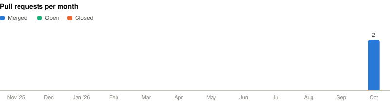

# Open Source Contributions

My pull requests to high-impact open source projects, refreshed daily by GitHub Actions.

<!-- BOARD:START -->
<!-- Generated by scripts/update-board.mjs. Edits inside this block are overwritten. -->

Repos with 20K+ stars · **2** merged · **0** open · **0** closed · **1** repo · **+9 −1** lines

<picture><source media="(prefers-color-scheme: dark)" srcset="docs/charts/activity-dark.svg"></picture>

<picture><source media="(prefers-color-scheme: dark)" srcset="docs/charts/repos-dark.svg"></picture>

| Status | Pull request | Repository | Changes | Landed |
|---|---|---|---:|---|
| 🔵 Merged | [\[MPS\] Break .grad reference cycles in TestMPS.\_linear\_helper](https://github.com/pytorch/pytorch/pull/201955) | pytorch/pytorch#201955 | +4 −0 | [2026-10-24](https://github.com/pytorch/pytorch/commit/6b60e667b536e497019d5911405a023d2a12c6a2) |
| 🔵 Merged | [\[MPS\] Halve test\_64bit\_binops peak memory so it fits 24 GB Macs](https://github.com/pytorch/pytorch/pull/201836) | pytorch/pytorch#201836 | +5 −1 | [2026-10-23](https://github.com/pytorch/pytorch/commit/86ca1f9efa96cb21ff452b81fdc9eddb611d3fa8) |

Updated 2026-10-25 05:12 UTC · [Dashboard](https://lsyurea.github.io/Open-Source/)
<!-- BOARD:END -->

How it works

- [`scripts/update-board.mjs`](scripts/update-board.mjs) finds every public PR I've authored outside my own repos, keeps repos with at least `minStars` stars, and regenerates this board, the charts, and the [dashboard](https://lsyurea.github.io/Open-Source/).
- A PR counts as merged if GitHub merged it or a commit closed it (e.g. PyTorch's merge bot).
- Filters live in [`board.config.json`](board.config.json). Local run: `GITHUB_TOKEN=$(gh auth token) node scripts/update-board.mjs`

