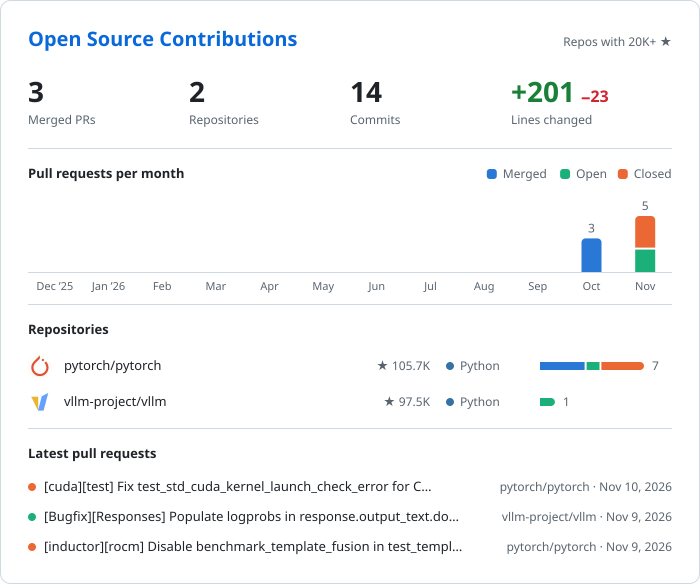

# Open Source Contributions

My pull requests to high-impact open source projects, refreshed daily by GitHub Actions.

<!-- BOARD:START -->
<!-- Generated by scripts/update-board.mjs. Edits inside this block are overwritten. -->

<a href="https://lsyurea.github.io/Open-Source/"><picture><source media="(prefers-color-scheme: dark)" srcset="docs/charts/card-dark.svg"></picture></a>

| Status | Pull request | Repository | Changes | Landed |
|---|---|---|---:|---|
| 🟠 Closed | [\[cuda\]\[test\] Fix test\_std\_cuda\_kernel\_launch\_check\_error for CUDA 13.0+](https://github.com/pytorch/pytorch/pull/204154) | pytorch/pytorch#204154 | +2 −5 | – |
| 🟢 Open | [\[Bugfix\]\[Responses\] Populate logprobs in response.output\_text.done streaming event](https://github.com/vllm-project/vllm/pull/66513) | vllm-project/vllm#66513 | +76 −1 | – |
| 🟠 Closed | [\[inductor\]\[rocm\] Disable benchmark\_template\_fusion in test\_template\_keeps\_its\_one\_config](https://github.com/pytorch/pytorch/pull/204018) | pytorch/pytorch#204018 | +5 −1 | – |
| 🟢 Open | [\[CUDA\] Handle unknown process memory in torch.cuda.list\_gpu\_processes](https://github.com/pytorch/pytorch/pull/203885) | pytorch/pytorch#203885 | +49 −3 | – |
| 🟠 Closed | [\[inductor\] Treat non-positive benchmark timings as invalid in autotune](https://github.com/pytorch/pytorch/pull/203857) | pytorch/pytorch#203857 | +57 −12 | – |
| 🔵 Merged | [\[MPS\] Relax the fp16 tolerance for combinations backward in TestConsistency](https://github.com/pytorch/pytorch/pull/202803) | pytorch/pytorch#202803 | +3 −0 | [2026-10-31](https://github.com/pytorch/pytorch/commit/60be10e8d32204d70af687411736ccb0d72de719) |
| 🔵 Merged | [\[MPS\] Break .grad reference cycles in TestMPS.\_linear\_helper](https://github.com/pytorch/pytorch/pull/201955) | pytorch/pytorch#201955 | +4 −0 | [2026-10-24](https://github.com/pytorch/pytorch/commit/6b60e667b536e497019d5911405a023d2a12c6a2) |
| 🔵 Merged | [\[MPS\] Halve test\_64bit\_binops peak memory so it fits 24 GB Macs](https://github.com/pytorch/pytorch/pull/201836) | pytorch/pytorch#201836 | +5 −1 | [2026-10-23](https://github.com/pytorch/pytorch/commit/86ca1f9efa96cb21ff452b81fdc9eddb611d3fa8) |

Updated 2026-11-25 11:20 UTC · [Dashboard](https://lsyurea.github.io/Open-Source/)
<!-- BOARD:END -->

How it works

- [`scripts/update-board.mjs`](scripts/update-board.mjs) finds every public PR I've authored outside my own repos, keeps repos with at least `minStars` stars, and regenerates this board, the summary card, and the [dashboard](https://lsyurea.github.io/Open-Source/).
- A PR counts as merged if GitHub merged it or a commit closed it (e.g. PyTorch's merge bot).
- My [profile README](https://github.com/lsyurea) calls the same workflow with `layout: profile`.
- Filters live in [`board.config.json`](board.config.json). Local run: `GITHUB_TOKEN=$(gh auth token) node scripts/update-board.mjs`

